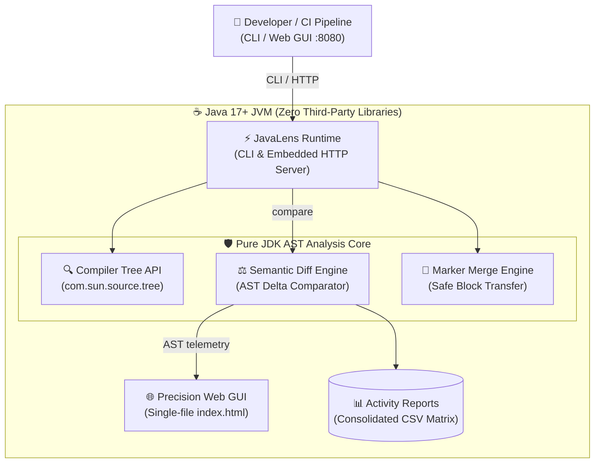
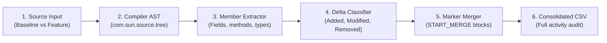
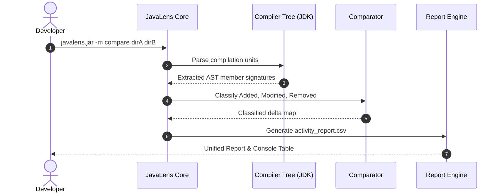
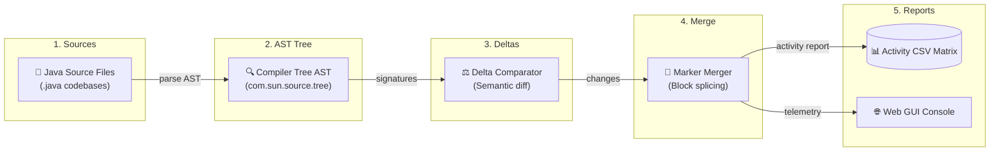
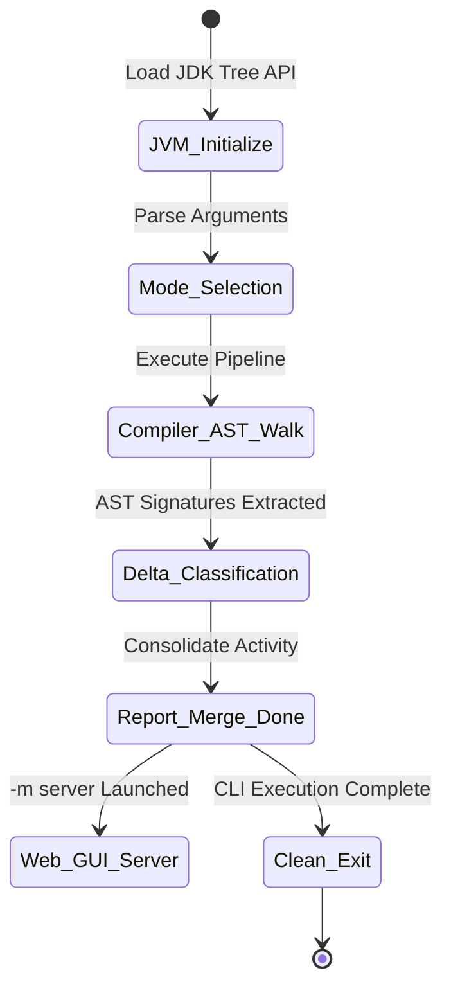

# JavaLens — Architecture & System Design

> **Executive Overview**: High-performance, zero-external-dependency static analysis and codebase synthesis engine for Java 17+ repositories. Powered directly by the standard OpenJDK Compiler Tree API (`com.sun.source.tree`), JavaLens provides microsecond AST parsing, semantic diffing, marker-guided safe merging, and an interactive cyber-dark Web GUI.

All system architectures, synthesis workflows, comparison sequences, data pipelines, and engine lifecycles are embedded below as native Mermaid diagrams with full architectural explanations.

---

## 🏛️ 1. System Architecture

### Architectural Breakdown & Component Responsibilities
* **Zero External Dependencies**: JavaLens relies exclusively on standard OpenJDK modules (`java.compiler`, `jdk.compiler`, `jdk.httpserver`). It contains 0 third-party JAR dependencies, eliminating supply-chain vulnerabilities, licensing overhead, and classpath collisions.
* **Java Compiler Tree API Core (`com.sun.source.tree`)**: Directly utilizes the Java compiler's native parser and scanner to build fully resolved Abstract Syntax Trees (CompilationUnitTree, ClassTree, MethodTree, VariableTree).
* **Semantic Diff Engine**: Compares AST trees at the symbol signature level rather than raw text line diffs. Accurately detects added, modified, overloaded, and removed methods even when code formatting, whitespace, or comments have shifted.
* **Marker Merge Engine**: Implements marker-guided code synthesis (`/* START_MERGE */ ... /* END_MERGE */`), allowing developers to transplant new or updated methods between codebase branches safely.
* **Embedded HTTP Server & Web GUI**: Standard `com.sun.net.httpserver.HttpServer` serving the single-file cyber-dark engineering GUI with REST telemetry endpoints (`/api/stats`, `/api/diff`, `/api/classes`).
* **Consolidated Activity Matrix**: Produces structured CSV reports auditing every class, field, method signature, cyclomatic complexity, and delta categorization.

---

## 🔄 2. Codebase Synthesis & Merge Workflow

### Operational Workflow Stages
1. **Source Discovery**: Recursively traverses baseline and target repository directories to collect `.java` source files.
2. **Compiler AST Parsing**: Compiles source strings into `CompilationUnitTree` instances using `JavacTask.parse()`.
3. **Symbolic Member Extraction**: Traverses AST nodes to catalogue types, interfaces, constructors, method signatures, return types, modifiers, and field declarations.
4. **Delta Classification**: Compares baseline member signatures against target signatures, categorizing each entity as ADDED, MODIFIED, UNCHANGED, or REMOVED.
5. **Marker-Guided Code Merging**: Synthesizes clean code blocks into destination source files, guarding insertions with non-destructive markers.
6. **Activity Matrix Generation**: Exports audit logs summarizing line churn, signature diffs, and structural changes.

---

## ⚡ 3. Semantic Comparison & Report Sequence

### Execution Sequence Details
* **Step 1**: Developer invokes JavaLens CLI with comparison mode (`-m compare`) specifying two repository roots.
* **Steps 2–3**: Core feeds source files to `com.sun.source.util.JavacTask`, receiving parsed AST trees and extracting member signatures.
* **Steps 4–5**: The comparator compares AST trees bidirectionally, building a structured delta map of signatures and line numbers.
* **Steps 6–7**: The report engine formats the results, outputting both formatted ANSI console tables and the comprehensive `activity_report.csv`.

---

## 🌊 4. AST Synthesis Data Flow Pipeline

### Data Pipeline Mechanics & Invariants
* **AST Streaming**: Files are parsed sequentially or via parallel streams without retaining unnecessary syntax tokens, keeping JVM heap overhead < 64MB even on 10,000+ class repositories.
* **Signature Normalization**: Parameter types are fully qualified where possible to distinguish between overloaded method signatures.
* **Non-destructive Splicing**: Merging preserves original source formatting, comments, and imports outside of designated merge blocks.

---

## ⏱️ 5. Analysis & Merge Pipeline Lifecycle

### State Transitions & Operational Modes
* **`JVM_Initialize`**: Verifies Java 17+ runtime and checks availability of `jdk.compiler` module.
* **`Mode_Selection`**: Dispatches execution based on CLI flags: `-m scan` (single repo audit), `-m compare` (semantic diff), `-m merge` (marker merger), or `-m server` (launch Web GUI).
* **`Compiler_AST_Walk`**: Executes parsing passes across target `.java` compilation units.
* **`Delta_Classification`**: Classifies structural diffs and computes codebase metrics.
* **`Report_Merge_Done`**: Writes persistent reports and completes merging.
* **`Web_GUI_Server`**: If server mode is requested, binds `http://localhost:8080` to serve the interactive web GUI.
