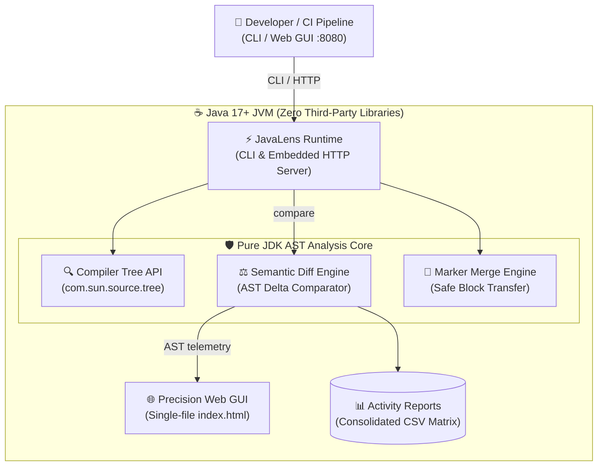
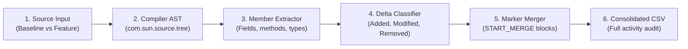
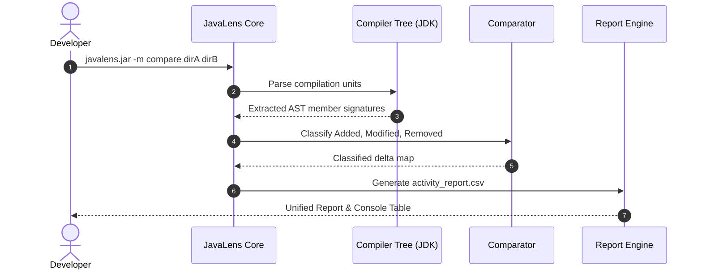
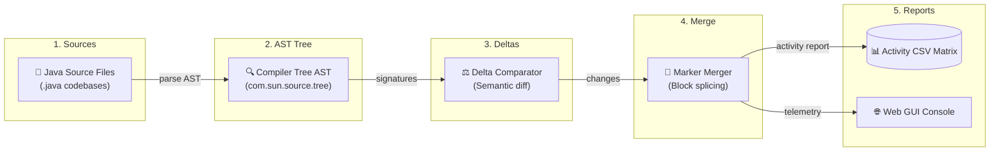
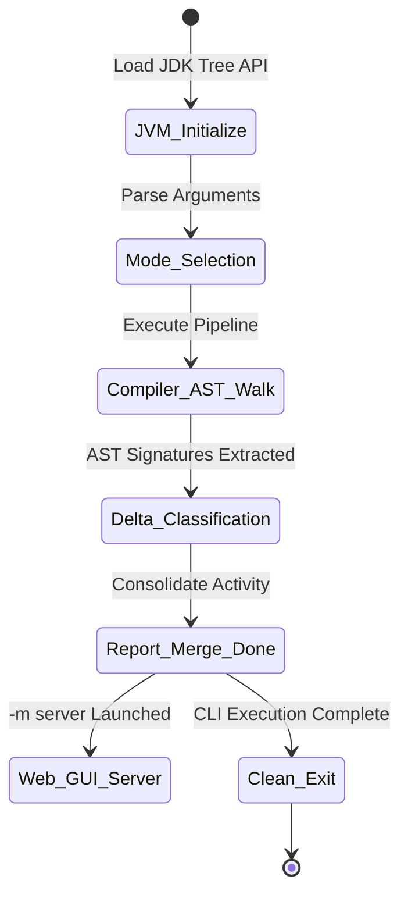

# JavaLens — Architecture & System Design

> **Overview**: Semantic Java codebase intelligence, AST synthesis, structural diffing, and merge analysis.

All system diagrams, operational workflows, execution sequences, data flow pipelines, and lifecycle state machines below are embedded natively using standard GitHub Mermaid syntax.

---

## 🏛️ System Architecture

---

## 🔄 Codebase Synthesis & Merge Workflow

---

## ⚡ Semantic Comparison & Report Sequence

---

## 🌊 AST Synthesis Data Flow Pipeline

---

## ⏱️ Analysis & Merge Pipeline Lifecycle

